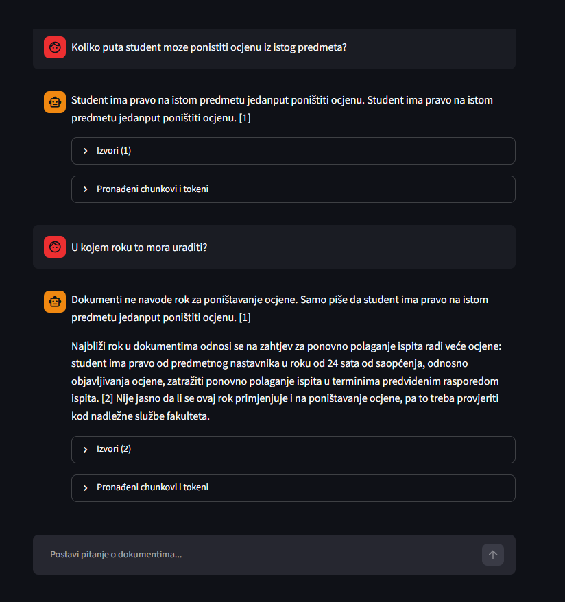

# RAG chatbot for Bosnian PDF documents

A chatbot that answers questions about Bosnian university documents (study regulations, course syllabi, assignment instructions). It answers **only** from the documents, cites the PDF and page for every claim, and says *"Ne znam"* ("I don't know") when the answer isn't there.

The focus of the project is **evaluation**: measuring retrieval and answer quality, and fixing what the measurements showed.




## Pipeline

```
INGEST   PDF ─► text per page (PyMuPDF)
             ─► chunks of ≤480 tokens, 50 overlap (counted with the e5 tokenizer)
             ─► context header "Document: … Course: …" (for embedding + BM25 only)
             ─► multilingual-e5-base embeddings ─► Chroma (clean text kept for citations)

QUERY    question ─► follow-up? rewrite into a standalone question (Haiku, no thinking)
                  ─► hybrid search: vector + BM25 (diacritics stripped), fused with RRF ─► top 5
                  ─► Claude Haiku 5.5 with the Citations API (one document block per chunk)
                  ─► answer with [n] markers + sources (PDF, page, quoted text)
```

## Stack

Python 3.11+, PyMuPDF, sentence-transformers (`intfloat/multilingual-e5-base`, runs locally), ChromaDB, rank_bm25, Anthropic SDK (Claude Haiku 5.5 for the app, Claude Sonnet 5.5 as judge), Streamlit.
No LangChain / LlamaIndex: every step is plain Python.

## Run it

```bash
python -m venv .venv
.venv\Scripts\activate            # Linux/macOS: source .venv/bin/activate
pip install -r requirements.txt
echo ANTHROPIC_API_KEY=sk-ant-... > .env

# put your own PDFs into data/pdfs/  (the original documents are not in the repo)
python src/ingest.py              # PDFs -> chunks -> embeddings -> chroma_db/
streamlit run app.py
```

Evaluation:

```bash
python eval/eval_retrieval.py --name myrun                  # free, deterministic
python eval/eval_answers.py  --name myrun [--search vector] # ~$0.11 per run
python eval/generate_testset.py                             # regenerates eval/test_set.json
```

Every run is saved to `eval/runs/<name>_*.json`, so runs can be compared instead of overwritten.

## Evaluation

**Test set: 31 questions**
- 25 **generated**: random chunks (seed 42, round-robin across PDFs, near-empty chunks filtered out); Haiku writes one realistic student question + short answer per chunk. Reviewed by hand; 7 were fixed because they said "this course" without naming it.
- 6 **manual**: 4 questions the documents don't answer (parking price, winter break, office hours, cafeteria), and 2 paraphrases of generated questions written with typos and without diacritics (`masinsko ucenje`).

**Code grader (retrieval):** for each question with a known source, run vector, BM25 and hybrid search and check whether the expected PDF + page is in the results. Reports hit@1 (correct page ranked first) and hit@5 (correct page anywhere in the top 5, which is what the model receives).

**Model grader (answers):** the app (Haiku) answers each question; a different, stronger model (Sonnet) judges the answer against the expected answer using structured outputs: `TAČNO / DJELIMIČNO / NETAČNO` (correct / partial / wrong), or `TAČNO / HALUCINACIJA` for questions with no answer in the documents. A code check flags answers that repeat the same 8-word phrase.

## Results

**Retrieval** (27 questions with a known source, top 5):

| method | hit@1 | hit@5 |
|---|---|---|
| vector | 74% | 85% |
| BM25 | 52% | 81% |
| hybrid (RRF) | 67% | **93%** |

**Answers** (27 answerable + 4 unanswerable):

| run | search | correct | partial | wrong | "don't know" when correct | hallucinations |
|---|---|---|---|---|---|---|
| baseline | hybrid | 24 | 0 | 3 | 4 / 4 | 0 |
| baseline_2 (same setup) | hybrid | 23 | 1 | 3 | 4 / 4 | 0 |
| vector_only | vector | 23 | 0 | 4 | 4 / 4 | 0 |

- **Noise:** running the identical setup twice changed one verdict (≈1 question out of 27). The overall difference between hybrid and vector is within that noise.
- Per question, though, the two methods differ systematically on 5 questions: hybrid wins when the question names the exact course or omits diacritics, vector wins on paraphrases and typos. Every flip matches the retrieval results.
- In every run, all wrong answers were "I don't know" caused by retrieval misses. The app did not hallucinate.

## What evaluation found

Hybrid hit@5 went from 70% to 93%. Not all of that is the system getting better:

| step | hybrid hit@5 | type |
|---|---|---|
| first measurement | 70% | |
| removed a duplicate PDF (29/35 pages identical to another file), re-pointed 7 questions to the remaining copy, fixed 5 questions that said "this course" | 78% | mostly **measurement** (hits on the duplicate were counted as misses); partly system (duplicates wasted top-5 slots) |
| fixed 2 more ambiguous questions | 85% | **measurement** |
| contextual chunk headers (course name + document) in embeddings and BM25 | 89% | **system**: 12 questions ranked higher, 1 lower |
| strip diacritics in BM25 (query and index) | 93% | **system**: fixed the `masinsko ucenje` paraphrase |

Also added from evaluation: the course name in each Citations document title (so the model doesn't mix up syllabi with identical text), and a prompt rule against repeating the same claim.

## Known limitations

- **No stemming:** Bosnian inflection ("Matematik**u**" vs "Matematik**a**") still breaks BM25 matches.
- **Similar course names** (Programiranje I / II / III) get confused by the embeddings.
- **Small test set:** 27 answerable questions, so one question is ≈4%. Generated questions come from a single chunk and are easier than real ones.
- **Retrieval eval matches on page, not chunk**, so it is slightly optimistic: in one case the right page was found but not the chunk with the answer.
- **The anti-repetition rule isn't 100%:** a repeated sentence still appears occasionally (1 of 31 answers in one run; also visible in the screenshot above).
- The LLM judge itself can be wrong; a sample of its verdicts should be checked by hand.
